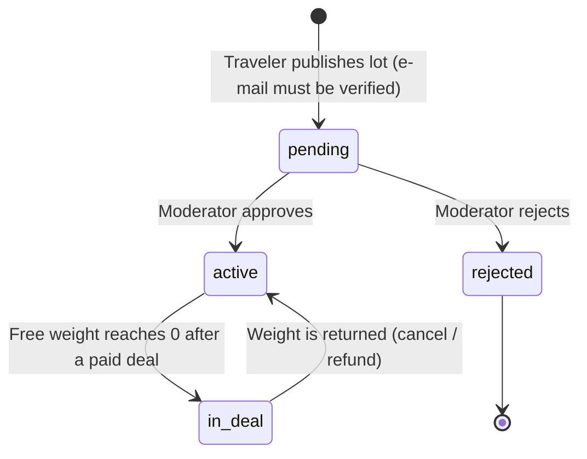
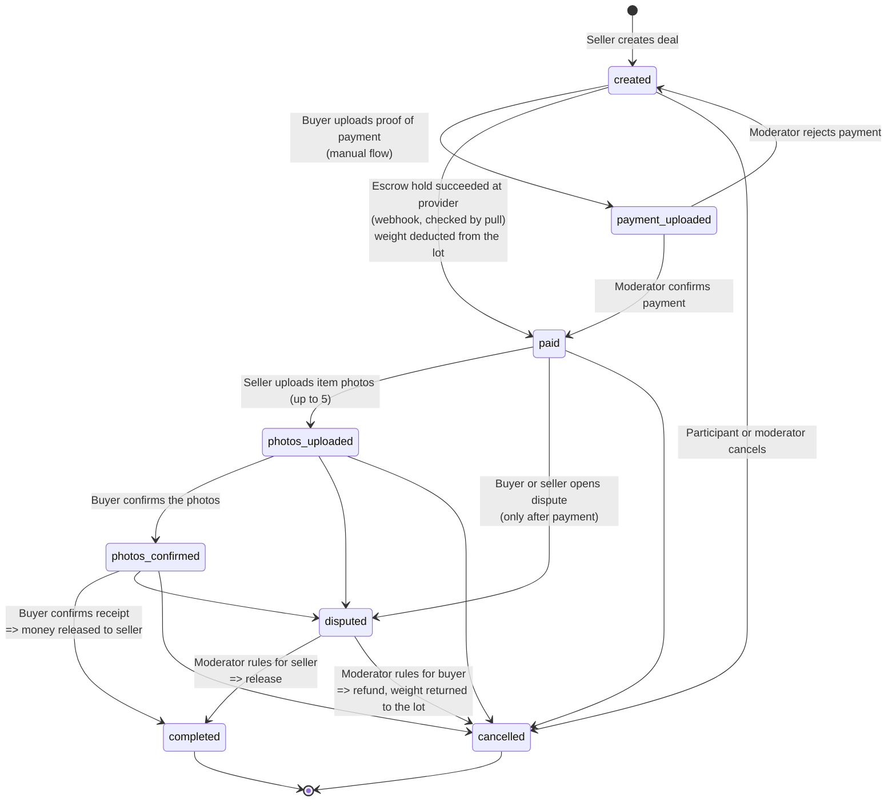
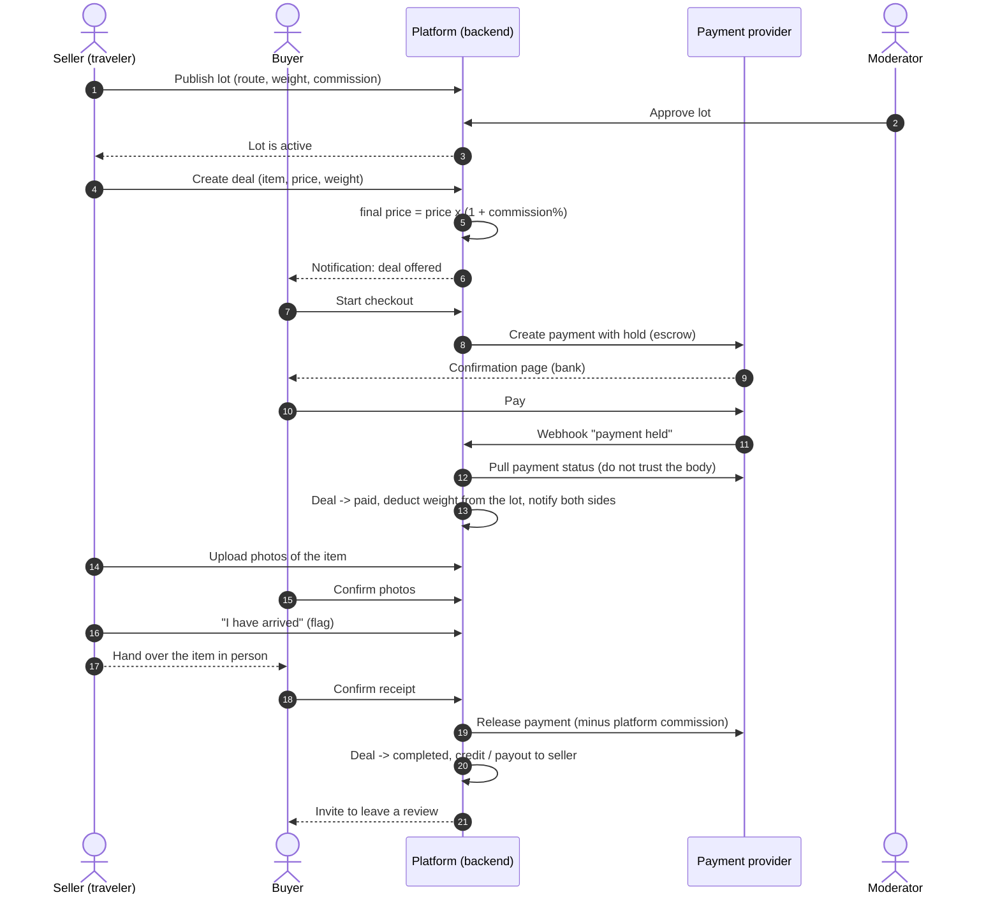
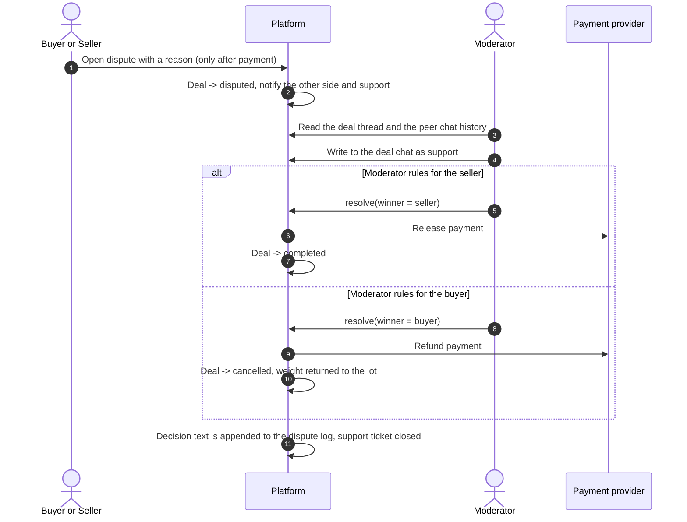

# Deal process (escrow)

How a deal moves from offer to payout. Everything below is derived from the backend code (statuses, guards and side effects), not from a wish-list.

**Actors:** *Seller* = the traveler who owns the lot and brings the item, *Buyer* = the person who orders it, *Moderator* (support), *Payment provider* (escrow hold at the acquirer), *Platform* (the Baggee backend).

## 1. Lot lifecycle

A lot is a traveler's trip offer. It is hidden from the catalog until a moderator approves it.

## 2. Deal states

The seller creates a deal **inside their own lot** (item, price, weight; optionally for a specific buyer). The platform adds its commission to the item price and checks that the requested weight fits the lot's free weight. The weight is **deducted from the lot only when the deal becomes paid**, so unpaid offers never block baggage space; if the free weight drops to zero the lot switches to `in_deal`.

Side flags that do **not** change the status: `seller_arrived` (one-time "I have landed" signal to the buyer) and `support_called` / `support_closed` (a support ticket can be opened and closed on a deal without changing its state).

### Guards worth noting (from the code)

| Rule | Where it matters |
|---|---|
| Only the lot owner can create deals; the lot must be `active`; requested weight must not exceed the lot's free weight | Only the traveler decides what they bring; offers cannot exceed the capacity |
| Weight is deducted on payment (idempotent flag `weight_deducted`) and restored on cancel or refund only if it was deducted | No double deduction, no double return |
| A dispute can be opened only after payment, when a buyer exists and money is in escrow | Support would have nobody to refund otherwise |
| `complete` is allowed only for the buyer and only from `photos_confirmed` | The buyer, not the seller, decides when money is released |
| Cancel is allowed to participants and moderators unless the deal is closed; it refunds a held payment and returns the weight to the lot | Keeps lot capacity and money consistent |
| Provider webhooks are **idempotent** (event ids are stored) and the platform **does not trust the webhook body**: it asks the provider for the payment status | Protects against duplicated or forged events |
| A failed or cancelled bank payment marks the payment `failed` and notifies the buyer; the deal stays `created` so the buyer can retry | Graceful payment failure |
| A demo "pay now" shortcut exists and is **disabled when real payments are on** | Safe separation of demo and production |

## 3. Happy path (sequence)

## 4. Dispute branch (sequence)

## 5. Money after completion

With the default payout mode the seller is paid when the deal closes (the platform does not hold other people's money longer than the escrow). An alternative mode credits an internal balance and the seller withdraws by request; withdrawals go through limits, a cooldown and optional manual review, and every balance change is written to the ledger. The legal consequences of holding balances (licensing) are the reason the first mode is the recommended default.
