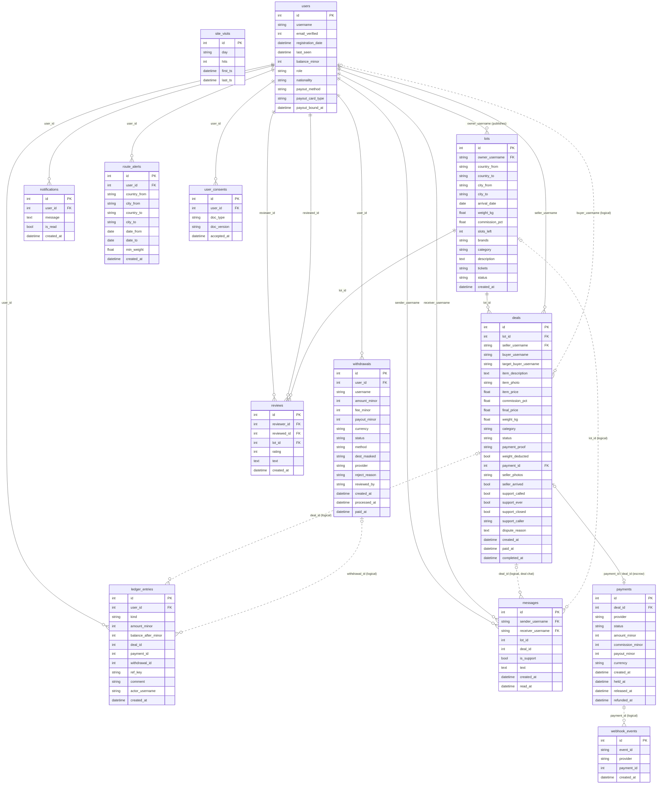

# Data model (ER)

Entity-relationship diagram of the Baggee database, **generated from the SQLAlchemy models** (13 tables, 15 declared foreign keys).
Solid lines are real foreign keys; dotted lines are *logical* links that the code maintains but the database does not enforce (for example `deals.buyer_username`, `messages.deal_id`, `ledger_entries.deal_id`).

> Security- and privacy-sensitive columns (password hash, e-mail hash/ciphertext, payout tokens, IP addresses, raw provider payloads, idempotence keys) are **intentionally omitted** from the diagram (22 columns).

## Tables at a glance

| Table | Purpose |
|---|---|
| `users` | Accounts, roles (`user` / `moderator` / `admin`), balance in minor units (kopecks), payout method |
| `lots` | A traveler's trip offer: route, arrival date, free weight, platform commission %, moderation status (`pending` → `active` / `rejected`) |
| `deals` | One item deal inside a lot: item, price, final price with commission, weight reserved, status, support/dispute flags |
| `payments` | Escrow payment of a deal at the payment provider: amounts in minor units, commission, payout, lifecycle timestamps (`held_at`, `released_at`, `refunded_at`) |
| `webhook_events` | Processed provider events, used for idempotency (the same event is never applied twice) |
| `messages` | Direct chats and the deal chat, including support (moderator) messages |
| `reviews` | Ratings and text between users, tied to a lot |
| `notifications` | In-app notifications |
| `route_alerts` | A user's subscription to routes / dates / minimum weight |
| `user_consents` | Consent log: which legal document version a user accepted and when (relevant for 152-FZ) |
| `ledger_entries` | Journal of balance changes (credit, adjustment, withdrawal) with the balance after each operation and an idempotency key |
| `withdrawals` | Withdrawal requests: `pending` → `processing` → `paid` (or cancelled / rejected), optionally with manual staff review |
| `site_visits` | Anonymous daily visit counters (hashed visitor id) |

## Design notes

- **Money is stored as integers** (`*_minor`, kopecks) to avoid floating-point errors; only the item price on a deal is still a float, which is a known inconsistency worth migrating.
- **The ledger explains the balance**: `ledger_entries.balance_after_minor` lets an admin audit endpoint detect any mismatch between `users.balance_minor` and the journal.
- **Escrow is two-sided**: `deals.payment_id` points to the current payment, `payments.deal_id` points back (the code comment calls it the *current* escrow payment, so a deal can be re-paid).
- **Soft links trade integrity for flexibility**: usernames and ids are used as logical keys in several places; adding real foreign keys is a candidate for the next schema iteration.
